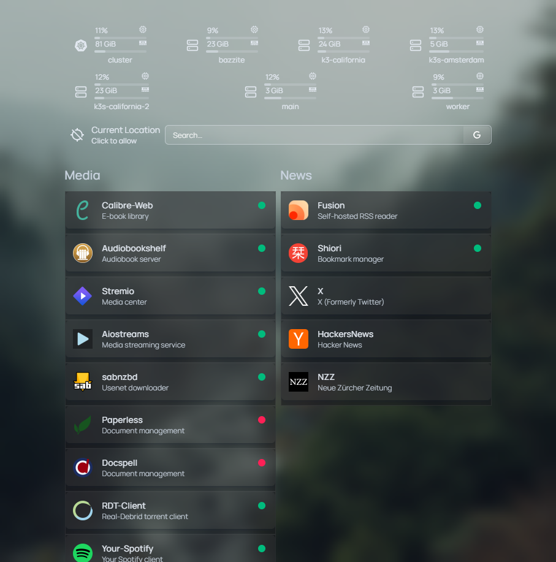
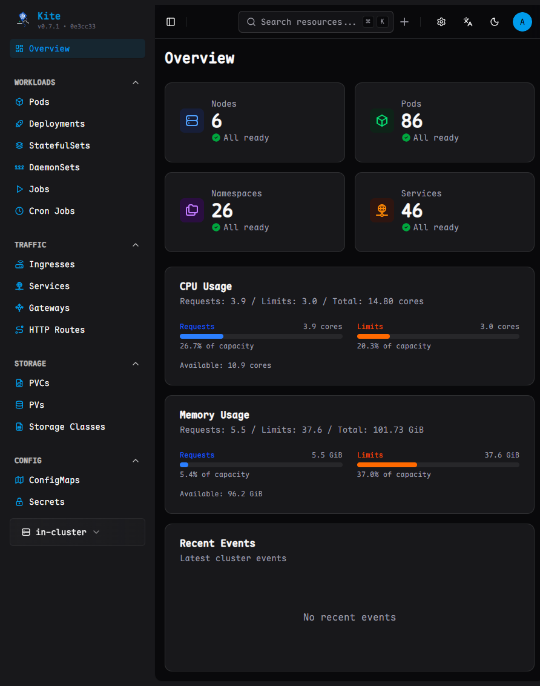
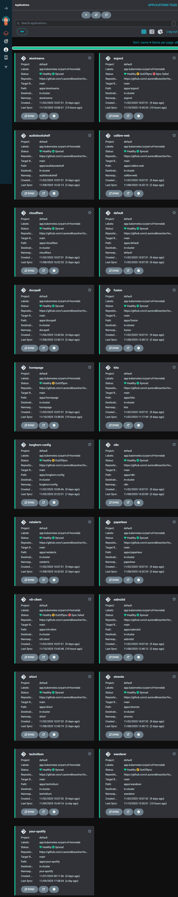

# Laurens Kubernetes Homelab

Public showcase + working GitOps config for my hobby [Kubernetes](https://kubernetes.io/) cluster. Manifests in `apps/` are what the live cluster runs via [ArgoCD](https://argo-cd.readthedocs.io/en/stable/). Infrastructure is managed with Ansible under `servers/ansible/`.

> **Public repo note:** application secrets are never stored in plaintext here. Runtime secrets use [Sealed Secrets](https://github.com/bitnami-labs/sealed-secrets) (ciphertext only) or cluster-local Secret objects. CI credentials live in GitHub Actions secrets. Do not commit kubeconfigs, join tokens, private keys, or `.env` files.

## Architecture versions

| | **V1** (retired) | **V2** (current, 2026-10) |
|---|---|---|
| Nodes | 7 nodes / 4 regions (CA ×2, London ×3, Amsterdam, Zurich/home) | 4 nodes: home `bazzite` + London agents ×3 |
| Control plane | Multi-server embedded **etcd** HA | Single K3s server on **bazzite** with **SQLite** |
| Storage | [Longhorn](https://longhorn.io/) + geo storage classes | K3s **`local-path`**: bazzite data disk, `/var/lib/rancher/k3s/storage` on London |
| Workload placement | Geo affinity (`europe` / `us` / `zurich`) | Stateful → bazzite; stateless can schedule on London |
| Pod overlay | Flannel `wireguard-native` (multi-region mesh) | Same CNI, peers on **public WAN** + tight nftables allowlist |
| Admin access | Tailscale | Tailscale for SSH/admin **only** (not CNI underlay) |
| Ingress | Cloudflare Tunnel(s) | Single Cloudflare Tunnel on bazzite |
| GitOps branch | `main` (pre-cutover) | `main` (V2 merged; was temporarily `v2`) |
| Why change | Powerful, but high ops cost (Longhorn rebuilds, etcd, multi-region) | Cut complexity/cost; keep GitOps + apps |

Cutover notes: [`PLAN.md`](PLAN.md), [`migration/STATUS.md`](migration/STATUS.md).

## V2 at a glance

```text
bazzite          K3s server (SQLite) + data-disk local-path PVCs + media hostPaths
k3s-london-1..3  K3s agents; local-path allowed at /var/lib/rancher/k3s/storage

Ingress:  Cloudflare Tunnel
CD:       ArgoCD ApplicationSets → branch `main`
Secrets:  Sealed Secrets
Backup:   restic → Backblaze B2 (SQLite db/ + token + PVC data)
```

Production-like settings on V2:

- Stateless fail-over across London agents + home control-plane
- Persistent data on bazzite via `local-path` (backed up to [Backblaze](https://www.backblaze.com/) with restic)
- CD via ArgoCD — changes under `apps/` auto-deploy when automated sync is enabled
- Ingress via [Cloudflare Tunnels](https://developers.cloudflare.com/cloudflare-one/connections/connect-networks/) (GitHub Actions syncs tunnel ingress; account/zones/DNS/tunnels adopted in Pulumi — see `infrastructure/cloudflare/`)
- Pod overlay: Flannel WireGuard on public WAN + nftables peer allowlist (not nested in Tailscale)
- Joining a new agent is a ~5 minute Ansible job
- Kubernetes secrets encrypted at rest; Sealed Secrets for GitOps-friendly ciphertext
- [Mend Renovate](https://www.mend.io/renovate/) opens PRs for dependency/image updates

# Security

## Network Security

### Secure Communication
- **WireGuard Backend**: Internal cluster communication uses WireGuard directly (not over Tailscale) to avoid double encapsulation issues
- **SSH Restricted to Tailscale and Approved Fallbacks**: SSH is available on Tailscale and only from explicitly approved public source IPs

### Firewall (nftables)
Host firewalling is enabled via Ansible (`firewall_enable: true`) using an `inet homelab` nftables table (input/forward default drop, output accept). It provides:

- **Port Scan Protection**: Drops NULL, SYN-FIN, SYN-RST, and FIN-RST scans
- **Anti-Spoofing**: Blocks spoofed loopback traffic (127.0.0.0/8 and ::1)
- **Rate Limiting**: ICMP echo limited to 5/second (essential PMTU / IPv6 ND always allowed)
- **Tailscale**: Underlay UDP/41641 allowed; all traffic arriving on `tailscale0` is trusted (management plane). Prefer Tailscale ACLs for tailnet segmentation.
- **SSH**: Allowed from the tailnet; off-tailnet SSH only from `firewall_k3s_api_extra_allowed_ips` (sshd still listens on `0.0.0.0` — restriction is nftables, not `ListenAddress`)
- **Cluster Traffic Only**: Kubernetes host ports are allowlisted from authorized sources:
  - Flannel WireGuard (51820/udp) from node WAN/peer IPs (`cluster_network_ip`, plus optional per-host `cluster_wan_ip` / `ansible_host` for NAT/home nodes)
  - node-exporter (9100/tcp) from node IPs and pod CIDR `10.42.0.0/16` (Prometheus scrapes from pods)
  - beszel-agent (45876/tcp) from node IPs and pod CIDR `10.42.0.0/16` (Beszel hub scrapes from its pod)
  - Kubelet API (10250/tcp) from cluster node IPs and pod CIDR `10.42.0.0/16` (metrics-server; node IPs cover pod-to-kubelet traffic SNATed to the source host)
  - K3s API (6443/tcp) and supervisor (9345/tcp) on control-plane nodes from cluster node IPs
  - K3s API (6443/tcp) from explicitly approved public join clients in `firewall_k3s_api_extra_allowed_ips`
  - etcd (2379-2380/tcp) between control-plane nodes
- **Forwarding**: Pod/CNI traffic via `cni0` / `flannel.1` / `flannel-wg` (and `10.42.0.0/16` egress safety net); accidental WAN NodePort exposure is blocked
- **Logging**: Rate-limited logging of dropped packets (10/minute)

## Intrusion Detection & Prevention

### CrowdSec
[CrowdSec](https://crowdsec.com/) provides real-time threat detection and automated mitigation:

- **Firewall Bouncer**: Integrated with nftables for IP blocking
- **Kubernetes Bouncer**: Monitors and protects Kubernetes workloads
- **Recommended Collections**: Pre-installed security rule collections
- **Cluster Whitelisting**: All cluster IPs whitelisted to prevent false positives
- **Console Enrollment**: Optionally enrolled in CrowdSec Console for centralized management
- **Automated Response**: Threat IPs are automatically blocked at the firewall level

## Security Updates

Automatic security patching is enabled through `dnf-automatic`:
- **Security-Only Updates**: Only security patches are applied automatically
- **Service Restarts**: Services are automatically restarted after updates
- **No Auto-Reboot**: Kernel updates do not trigger automatic reboots (manual intervention required)

## System Hardening

### Resource Protection
Critical services are protected against OOM (Out of Memory) kills:
- **K3s**: OOMScoreAdjust=-400
- **Tailscale**: OOMScoreAdjust=-900
- **Chrony (NTP)**: OOMScoreAdjust=-900

### System Stability
- **Log Management**: Journald configured with rotation (2GB max, 1 month retention)
- **Time Synchronization**: Chrony NTP client ensures accurate time across all nodes
- **CPU Governor**: Set to performance mode for consistent performance

### Mandatory Access Control (SELinux)
- **SELinux Enforcing**: SELinux is configured in enforcing mode with targeted policy on supported nodes
- **Per-Node Exception Support**: Hosts with known compatibility issues can opt out via inventory variable (currently used for `k3s-london-3`)

## Kubernetes Security

### Secrets Management
- **Encryption at Rest**: Kubernetes secrets are encrypted using [K3s secret encryption](https://docs.k3s.io/installation/datastore#secret-encryption)
- **No Secrets in Repo**: Secrets are never committed to this repository
- **Sealed Secrets**: Uses [Sealed Secrets](https://github.com/bitnami-labs/sealed-secrets) for secret management

### Access Control
- **RBAC**: Role-based access control enabled by default
- **Network Policies**: Flannel CNI provides network segmentation
- **Pod Security**: Security contexts enforced on all deployments

### Runtime Sandboxing
- **Seccomp Default Enabled**: Kubelet runs with `seccompDefault: true`, applying RuntimeDefault seccomp profiles by default

# Screenshots






# Hardware

## V2 (current)

| location | ram  | cpu                | Storage | role           | note                         | cost/y |
| -------- | ---- | ------------------ | ------- | -------------- | ---------------------------- | ------ |
| Zurich   | 32GB | 4c (Intel N97)     | NVMe    | control plane  | Home `bazzite`; all PVCs     | $0     |
| London   | 5GB  | 2c (Xeon Gold 6148)| NVMe    | agent          | `k3s-london-1`               | ~$20   |
| London   | 5GB  | 2c (Xeon Gold 6148)| NVMe    | agent          | `k3s-london-2`               | ~$20   |
| London   | 8GB  | 4c (AMD EPYC 7542) | NVMe    | agent          | `k3s-london-3`               | ~$35   |

~50 GB RAM / 12 cores. Stateful apps + media live on the home node; London nodes take overflow/stateless load.

## V1 (retired — multi-region experiment)

V1 was a 7-node / 4-region mesh (~118 GB RAM / 20 cores, ~$100/year) with Longhorn + embedded etcd HA across California ×2, London ×3, Amsterdam, and home. Great learning setup; too much operational surface for the value. Soft-decommissioned after the V2 soak (see `migration/STATUS.md`).

# Apps

I'm currently running the following apps:

- [AIOStreams](https://github.com/Viren070/AIOStreams) - Streaming content aggregator
- [ArgoCD](https://argo-cd.readthedocs.io/en/stable/) - Declarative GitOps CD for Kubernetes
- [Audiobookshelf](https://www.audiobookshelf.org/) - Self-hosted audiobook and podcast server
- [Backrest](https://github.com/garethgeorge/backrest) - Web UI for restic backups
- [BentoPDF](https://github.com/bentopdf/bentopdf) - Convert HTML to PDF
- [Bookshelf](https://github.com/pennydreadful/bookshelf) - Self-hosted book catalog for web novels and fanfiction
- [Calibre Web](https://github.com/crocodilestick/Calibre-Web-Automated) - Enhanced version of Calibre web
- [Cloudflare Tunnel](https://developers.cloudflare.com/cloudflare-one/connections/connect-networks/) - Secure ingress to the cluster
- [FlareSolverr](https://github.com/FlareSolverr/FlareSolverr) - Proxy server to bypass Cloudflare protection
- [Forgejo](https://forgejo.org/) - Self-hosted Git service
- [Fusion](https://github.com/0x2E/fusion) - Lightweight RSS Reader
- [Gatus](https://github.com/TwiN/gatus) - Synthetic uptime monitoring and status page
- [Homepage](https://gethomepage.dev/) - A highly customizable homepage/dashboard
- [it-tools](https://github.com/corentinth/it-tools) - Collection of handy online tools for developers, with great UX
- [Kite](https://github.com/zxh326/kite) - Kubernetes dashboard
- [Linkwarden](https://github.com/linkwarden/linkwarden) - Collaborative bookmark manager
- [Listenarr](https://github.com/therobbiedavis/Listenarr) - Automated audiobook downloader and library manager
- [mydia](https://github.com/getmydia/mydia) - Self-hosted media manager
- [NZBGet](https://nzbget.com/) - Usenet downloader
- [obsidian-live-sync](https://github.com/vrtmrz/obsidian-livesync) - Live sync for Obsidian
- [openagent](https://github.com/e2b-dev/openagent) - AI agent framework
- [playarr](https://github.com/maikboarder/playerr) - Audiobook manager for Plex
- [prowlarr](https://github.com/Prowlarr/Prowlarr) - Indexer manager
- [qbittorrent](https://github.com/qbittorrent/qBittorrent) - BitTorrent client
- [questarr](https://github.com/doezer/questarr) - Quest manager for audiobooks
- [radarr](https://github.com/Radarr/Radarr) - Movie collection manager
- [RDT-Client](https://github.com/rogerfar/rdt-client) - Real-Debrid torrent client
- [SABnzbd](https://sabnzbd.org/) - Usenet downloader
- [shelfarr](https://github.com/DerGoogler/Shelfarr) - Audiobook library manager
- [Shiori](https://github.com/go-shiori/shiori) - Simple bookmark manager
- [sonarr](https://github.com/Sonarr/Sonarr) - TV show collection manager
- [Stremio](https://www.stremio.com/) - Media streaming platform
- [Wanderer](https://github.com/Flomp/wanderer) - Self-hosted trail and route planner
- [your-spotify](https://github.com/Yooooomi/your_spotify) - Self-hosted Spotify statistics and analytics

## To Explore

- [ ] [Dawarich](https://github.com/Freika/dawarich) - Self-hosted alternative to Google Timeline
- [X] [DNS Blocklist](https://github.com/hagezi/dns-blocklists?tab=readme-ov-file#overview) - DNS Blocklist
- [ ] [Github-to-sops](https://github.com/tarasglek/github-to-sops) - Easy way to integrate secrets in GIT
- [ ] [LLocalSearch](https://github.com/nilsherzig/LLocalSearch) - Local AI-powered search engine
- [ ] [Netvisor](https://github.com/mayanayza/netvisor?tab=readme-ov-file) - Netvisor, overview of network and services
- [ ] [Open WebUI](https://github.com/open-webui/open-webui) - User-friendly WebUI for LLMs
- [ ] [Pumpkin](https://github.com/Snowiiii/Pumpkin) - Minecraft server implementation in Rust
- [ ] [Quartz 4](https://quartz.jzhao.xyz/) - Static site generator
- [ ] [Calibre Web Automated Book Downloader](https://github.com/calibrain/calibre-web-automated-book-downloader) - Automatically download (and add) books to Calibre web
- [ ] [daedalOS](https://github.com/DustinBrett/daedalOS) - Desktop enviroment in the browser
- [ ] [VSCode web](https://github.com/coder/code-server) - Web version of VSCode
- [ ] [Khoj](https://github.com/khoj-ai/khoj) - Self-hosted AI second brain
- [ ] [hotpot](https://github.com/erik/hotpot) - Render customizable activity heatmap images from GPS tracks extracted from GPX, TCX, and FIT files. Includes a built-in web server for XYZ tiles and endpoints to add new data via HTTP POST or Strava webhooks.

# Adding new nodes

## Preparation

1. Copy your ssh key:

```bash
ssh-copy-id -i ~/.ssh/id_rsa_kubernetes root@<IP_ADDRESS>
```

2. Install Tailscale

```bash
curl -fsSL https://tailscale.com/install.sh | sh
tailscale up
```
3. Add new node to servers/ansible/hosts.ini

4. Deploy:

```bash
uv run ansible-playbook -i hosts.ini site.yml -u root --private-key ~/.ssh/id_rsa_kubernetes
```

5. Reboot (to ensure that the new mainline kernel is loaded)

6. Connect to cluster:

### Control-plane-node
```bash
curl -sfL https://get.k3s.io | INSTALL_K3S_CHANNEL=latest K3S_TOKEN=<TOKEN> sh -s - server --server https://<IP_ADDRESS_OF_NODE>:6443
```

### Agent
```bash
curl -sfL https://get.k3s.io | INSTALL_K3S_CHANNEL=latest K3S_URL=<IP_ADDRESS_OF_NODE> K3S_TOKEN=<TOKEN> sh -
```

Example public-WAN join, after adding the client IP to `firewall_k3s_api_extra_allowed_ips`:

```bash
curl -sfL https://get.k3s.io | INSTALL_K3S_CHANNEL=latest K3S_URL=https://46.33.10.93:6443 K3S_TOKEN=<TOKEN> sh -
```

Ansible configures the nodes with the following:

- Automatic security updates enabled and services are automatically restarted (if needed) 
- SSH hardened and firewalled (Tailscale + approved WAN fallback IPs; sshd listens on all interfaces)
- Host firewall (nftables) enabled for cluster/WAN traffic with CNI-aware forwarding
- SELinux enforcing enabled on compatible hosts (with per-node exception support)
- Kubernetes kubelet `seccompDefault` enabled
- ZSWAP + disk swap (migrated from ZRAM on V2)
- Network and other tweaks applied to optimize for Kubernetes usage
- K9S, Kubecolor and useful aliases automatically applied

# Tips & Tricks

## Control-plane datastore (V2 SQLite)

V2 uses K3s **SQLite**, not embedded etcd. Built-in `etcd-snapshot` / etcdctl workflows from V1 **do not apply**.

Backup essentials on the server node (`bazzite`):

- `/var/lib/rancher/k3s/server/db/`
- `/var/lib/rancher/k3s/server/token` (required; related to secret encryption)

Prefer a short K3s stop or `sqlite3 .backup` for consistency, then restic → B2. See `PLAN.md` for restore notes.

## Add debug container to pod

```bash
kubectl debug -it my-pod --image=busybox
```

## Run test container on specific node

```bash
kubectl run busybox-bazzite --image=busybox:latest --restart=Never --overrides='{"spec":{"nodeName":"k3s-london-1"}}' -- /bin/sleep 3600
```

## Monitoring configuration for Kite
Kite resets its settings on every upgrade, URL to enable the prometheus integration is:

```
http://prometheus-kube-prometheus-prometheus.monitoring.svc.cluster.local:9090
```