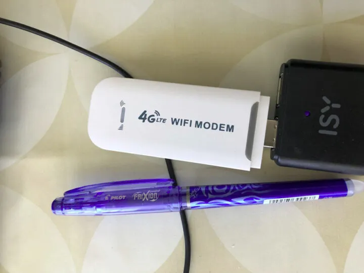
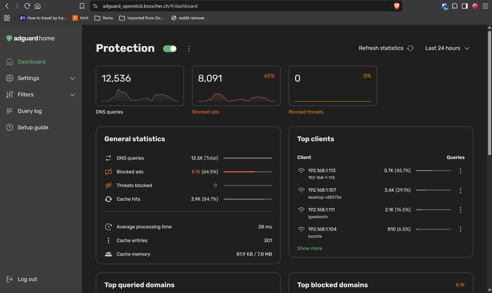
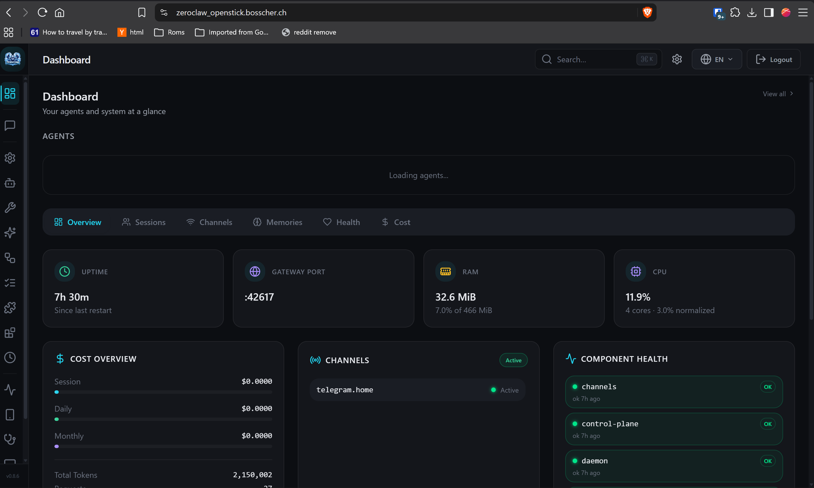
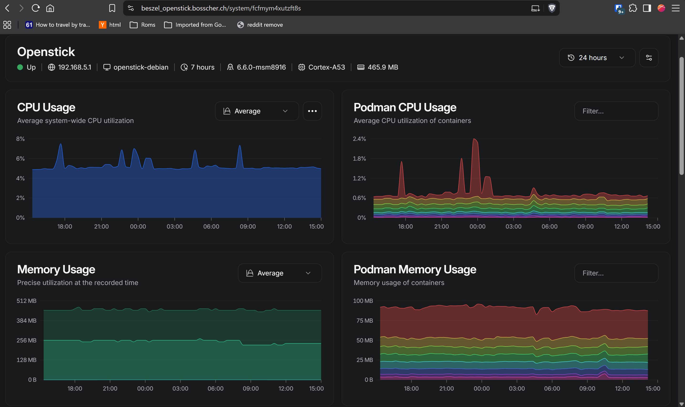
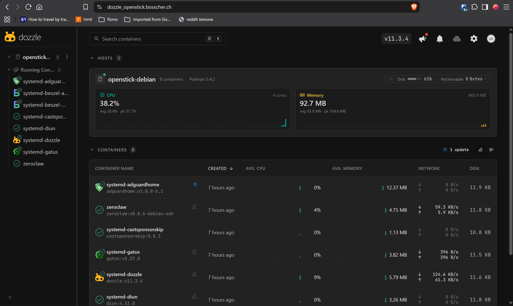
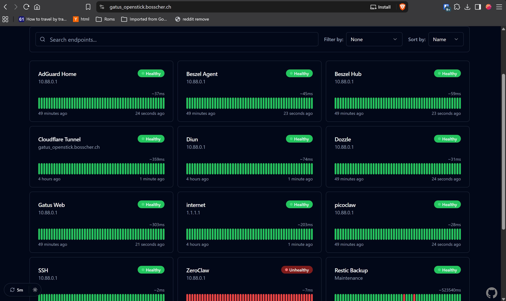

A while ago I bought an [OpenStick](https://hackaday.com/2022/08/03/hackable-20-modem-combines-lte-and-pi-zero-w2-power/) on a whim for 10 dollars (including shipping!) because it seemed like such a cool novelty piece of hardware.

For 10 dollars you get:

- 512 MB of RAM (~450 MB usable)
- 4x ARM Cortex-A53 CPU cores at 1 GHz
- 4 GB eMMC flash
- 150 Mbit/s Wi-Fi
- 4G modem and GPS
- Passively cooled, so 100% silent!
- 1 programmable LED :)

Now, you might look at this hardware and think "my watch is more powerful than that", and you wouldn't necessarily be wrong, but there's still a lot of fun to be had with a device this size, and it's a great gadget to get started with self-hosting.

The installation process is a bit involved, but once you're up and running it runs Debian, which brings all the classic goodies such as systemd (among other things, a scheduler and service monitoring for Linux) and Podman (lightweight containerization). For 10 USD you basically get a home server with minimal power usage and zero noise!

There's actually a lot of useful software that runs great on this thing. Some of my favorites are:

## CastSponsorSkip (5–10 MB)

This is a little service that connects to any running Google Cast device and skips sponsorships (and sometimes ads). It barely uses any resources, and after a while you forget that it exists, but it does make the whole YouTube experience a lot nicer!

[CastSponsorSkip](https://github.com/gabe565/CastSponsorSkip)

## AdGuard Home - my own fork (40 MB)

AdGuard Home blocks bad domains at the DNS level: spyware, malware, and so on. These days devices have a tendency to spy on you. [Smart TVs](https://www.youtube.com/watch?v=6IFVTcM28KA) run content recognition continuously, [washing machines](https://www.reddit.com/r/gadgets/comments/196bb6c/your_washing_machine_could_be_sending_37_gb_of/) scan your network, and your [coffee maker](https://medium.com/@staneyjoseph.in/your-coffee-maker-might-be-spying-on-you-the-scary-reality-of-iot-0d4e8b6b21c2) might be spying on you.

A DNS blocker cannot block all bad requests (you'll need a proper firewall for that), but it sure can block a whole lot. After adding a few blocklists, 60% of my queries are now blocked. Most seem harmless, but I'm pretty sure that some aren't.

I'm running my own fork, which can handle large blocklists in an efficient manner, but you probably shouldn't run binaries provided by random strangers, so I've also included the link to the official version below (which is totally fine if you limit yourself to smaller blocklists).

[AdGuard Home Next-Gen](https://github.com/LaurensBosscher/AdGuardHome-Next-Gen) - 40 MB (independent of the size of the blocklist)
[AdGuard Home](https://github.com/AdguardTeam/AdGuardHome/) - 40 MB (with a small (200k) blocklist)

## Zeroclaw (64 MB)

Zeroclaw is an AI agent harness. It supports 30 channels (Telegram, email, WhatsApp, etc.), has sensible security defaults, a nice web UI, and integrations with all the major LLM providers.

I ran OpenClaw for a while on my Kubernetes cluster, but it mostly caused a lot of frustration: it worked, but it used 1 GB+ of memory, broke with every update, and they kept changing functionality in ways that broke my existing workflows. Zeroclaw feels like a breath of fresh air. It uses ~3 MB RSS when idle, covers all the functionality that I need, and the security defaults are sensible and easy enough to disable. The next version will (hopefully!) have rich message support for Telegram, implemented by yours truly. The [PR](https://github.com/zeroclaw-labs/zeroclaw/pull/11862) can be tracked here!

I've given Zeroclaw access to the OpenStick (but nothing beyond that). Effectively it's a root shell, but given that the blast radius is limited, I figured it would be acceptable. I mostly use this to monitor the OpenStick, with questions such as "anything in the logs that requires my attention?" or "how is the disk space?". The biggest advantage is that it communicates through Telegram, so if I'm in the mountains with limited signal, I can still ask it how my little server is doing :)

I looked at alternatives such as Picoclaw and Nullclaw, and no doubt they're good as well. However, Zeroclaw seemed to have the best documentation and the most active community, so I went with that :)

[GitHub Zeroclaw](https://github.com/zeroclaw-labs/zeroclaw)
[Documentation](https://docs.zeroclaw.com/v0.8.7/en/)

## Cloudflare Tunnel (~8-20 MB)

Cloudflared makes it possible to expose all these services securely to the big, bad internet, for free, without exposing any ports. The downside might be that the NSA might be able to read everything you do, but for a homelab I consider that to be an acceptable trade-off.

[Cloudflare Tunnel](https://developers.cloudflare.com/tunnel/)

## Beszel (20 MB)

Beszel shows a pretty graph of memory, CPU usage, and so on, and alerts you if something looks suspicious, all while using very little memory.

I ran Grafana and the whole stack on my Kubernetes cluster for a while, and it's powerful, but not extremely user friendly, and it felt like overkill.

Beszel is a really awesome solution: it looks pretty and requires ~20 MB, 10 MB for the agent and 10 MB for the server. It has built-in alerting for a whole bunch of protocols, and I let it send messages to Telegram when something requires my attention.

[GitHub Beszel](https://github.com/henrygd/beszel)

## Dozzle

Dozzle is a pretty interface for managing Podman containers. It has a large overlap with Beszel, so if I ever need to save 10 or 20 MB, I'll get rid of one of them. Dozzle has a way better interface for checking Podman logs, but it doesn't offer the same level of stats as Beszel does.

[GitHub Dozzle](https://github.com/amir20/dozzle)

## Gatus (10 MB)

Beszel monitors your server(s). Gatus monitors your services. In other words, if you would like to get a notification when your webserver or database has crashed, you'll want Gatus. It also creates a really pretty web interface!

[GitHub Gatus](https://github.com/TwiN/gatus) - 10 MB

## Fusion RSS (22 MB)

RIP [Google Reader](https://en.wikipedia.org/wiki/Google_Reader). I tried [Feedly](https://feedly.com/i/pro) for a while, but 7 USD for the Pro version was just a little bit more than I felt comfortable with. Besides, why pay when you can have hours of fun setting up your own alternative?

I tried a whole bunch of RSS readers and eventually settled on Fusion. It does all I need, looks good, feels responsive, and uses 22 MB of RAM.

[GitHub Fusion](https://github.com/0x2E/fusion) - 22 MB

## Shiori (~10–20 MB)

Browser bookmarks are great, however a lot of my older bookmarks have stopped working because the sites disappeared, the URLs changed, or for a myriad of other reasons. Shiori fixes this by offering a great bookmark manager that also automatically archives the website. It does so in ~10 MB. You can expect some spikes when archiving, but nothing that our mighty OpenStick cannot handle!

[Shiori](https://github.com/go-shiori/shiori) - 10 MB

## Diun (9 MB)

Just a little service that sends a message to my Telegram whenever one of my containers has an update available.

[Diun](https://crazymax.dev/diun/) - 9 MB